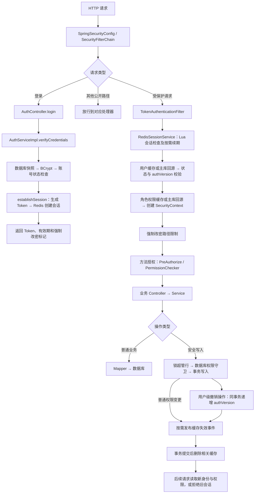
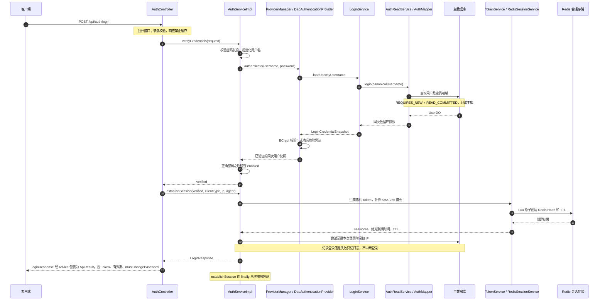
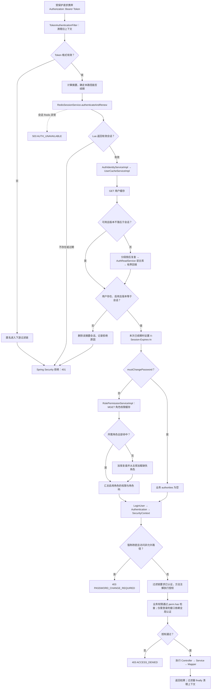
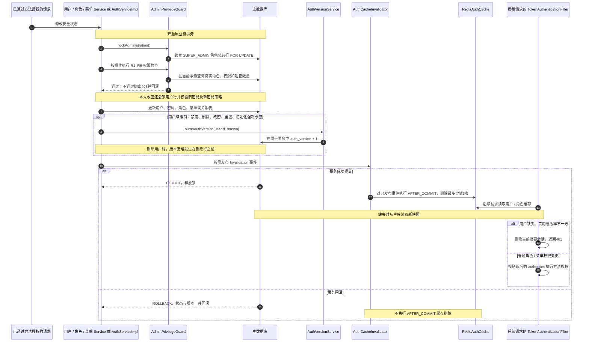

# 后端认证与安全整体链路

按当前代码整理。认证采用不透明 Bearer Token，HTTP 请求不使用服务端 HttpSession；Redis 保存会话，数据库保存用户、角色、菜单及认证版本。

## 1. 整体链路

图中展开成功主链；认证失败、基础设施故障及事务回滚分支见后面的细图。普通业务写入是否需要权限守卫，取决于是否修改用户、角色、菜单等安全状态；新建对象不存在旧缓存时不需要执行对应的失效操作。

## 2. 分层及代码职责

| 所在模块 / 包                         | 主要类                                                                                                                                          | 职责                                                                 |
|----------------------------------|----------------------------------------------------------------------------------------------------------------------------------------------|--------------------------------------------------------------------|
| admin-bootstrap                  | 启动类、application 配置、Flyway V4                                                                                                                 | 组装应用、加载安全参数和数据库迁移                                                  |
| admin-common                     | AuthErrorCode、ApiResult                                                                                                                      | 错误码和统一响应模型                                                         |
| admin-framework / framework      | SpringSecurityConfig、TokenAuthenticationFilter、PermissionChecker、TokenService                                                                | 安全过滤链、请求身份、方法授权、令牌生成与摘要；定义 SessionService 和 AuthIdentityService 接口 |
| admin-framework / infrastructure | RedisSessionService、RedisAuthCache、Lua                                                                                                       | 实现 Redis 会话及缓存                                                     |
| admin-system / modules.security  | AuthController、AuthServiceImpl、AuthIdentityServiceImpl、用户/角色缓存服务、AuthReadService、AdminPrivilegeGuard、AuthVersionService、AuthCacheInvalidator | 登录及改密业务、身份组装、数据库权威读取、安全写入守卫与提交后失效                                  |
| admin-system / modules.system    | 用户/角色/菜单 Controller、Service、Mapper                                                                                                           | 承载原有业务；在安全写事务中调用守卫、版本服务和失效服务                                       |

框架过滤器通过 AuthIdentityService 接口获取身份；AuthIdentityServiceImpl 在系统模块中实现该接口。权限写入守卫直接使用当前事务里的数据库数据，缓存回源使用
AuthReadService 的独立短事务。

## 3. 登录与建立会话

Token 使用 32 字节安全随机数，经 Base64URL 编码为 43 个字符；Redis 会话键为 `rooe:auth:session:<SHA-256摘要>`。会话记录保存创建时的
authVersion，不包含密码。

默认空闲期限为30分钟、绝对期限为12小时；续期只能延长空闲期限，不能越过绝对期限。登录和修改密码不做次数限流；登录记录的 IP 取
remoteAddr。

## 4. 每次请求的认证与授权

角色权限缓存命中时直接组装 authorities；回源只发生在缺失、过期、损坏或缓存不可用等情况。用户缓存若落后于当前会话版本，会先回源修复；若最终用户快照与会话版本不相等，则拒绝会话。

强制改密只允许 `/api/auth/me`、`/api/auth/password`、`/api/auth/logout`、`/api/auth/touch`。权限检查支持启用的 SUPER_ADMIN
角色；不依据用户 isAdmin 标志放行。

认证准备阶段的运行时异常由过滤器转换为503；下游业务异常由业务异常处理链处理。过滤器执行的各分支最终都会清理上下文。公开路径由
shouldNotFilter 跳过；OPTIONS 由安全链允许，跨域预检由 CORS 处理。

普通非强制改密请求在用户、角色缓存命中且 Redis 脚本预热时，认证部分为：一次会话 Lua、一次用户 GET、一次角色 MGET，共3次 Redis
操作、0次数据库读取。该预算不包含业务处理器自己的查询。

缓存回源通过 `AuthReadService` 的独立 READ_COMMITTED 事务读取主库，回填截止时间在查询前计算；NX/PXAT 与
compare-and-refresh 避免覆盖并发新值、延长旧快照寿命。用户缓存默认60秒、角色权限默认5分钟，均有约±10%抖动。缓存读写故障会尝试数据库回源；会话存储故障直接拒绝请求。

## 5. 安全写入、权限更新与会话失效

R1–R6
的职责分别为：限制授予用户的权限、限制角色/菜单权限扩张、限制修改自身角色关系及所持角色的权限/状态、保护超管角色、保护超管账户、保护自身禁用/删除及最后一个启用超管。具体条件以各守卫方法为准，超管也需要遵守适用于自己的保护规则。

普通角色关系、角色权限和菜单权限变化通过提交后缓存失效更新 authorities，不统一递增用户
authVersion。用户禁用、删除、改密、重置密码及初始化强制改密才走用户级版本撤销链路。

失效事件在进程内处理；进程崩溃或删除重试失败时仍依赖缓存 TTL 收敛，不能把数据库提交理解为所有已有会话立即收到撤销通知。初始化器
InitialAdminInitializer 在配置初始密码且满足历史演示账户条件时，执行单独的启动事务，锁角色/用户并更新密码、强制改密标记和版本，再提交后失效缓存。

## 6. 认证端点及错误返回

| 端点                      | 过滤器之后的主要业务                                      |
|-------------------------|-------------------------------------------------|
| POST /api/auth/login    | 凭证验证、随机令牌、创建 Redis 会话                           |
| GET /api/auth/me        | 从 principal 读取身份，查询用户展示数据及有效权限，返回强制改密标记         |
| POST /api/auth/touch    | 续期发生在过滤器中；Controller 无额外写入，返回204                |
| POST /api/auth/logout   | 此路径不续期；AuthServiceImpl 删除当前摘要对应的 Redis 会话，返回204 |
| POST /api/auth/password | 限流、锁与守卫、密码校验、事务内改密及版本递增、提交后失效，成功204             |

普通退出只删除当前会话，没有用户会话索引、会话列表、批量踢人链路。用户级版本撤销由后续请求逐个识别旧会话。

| 场景                   | 返回链路                            |
|----------------------|---------------------------------|
| 未认证、会话失效、凭证错误、账号禁用   | 401；包含 WWW-Authenticate: Bearer |
| 方法权限不足、守卫拒绝、强制改密路径限制 | 403                             |
| 会话基础设施不可用、无法完成身份确认   | 503                             |
| 参数或密码策略不满足           | 400                             |

过滤链失败由 SecurityErrorResponseWriter / Security 的入口与拒绝处理器输出；进入 MVC 后的异常由 GlobalExceptionAdvice
转换为统一 ApiResult。AuthTelemetry 在登录、续期、拒绝、版本变化及失效失败等位置记录指标和审计。
